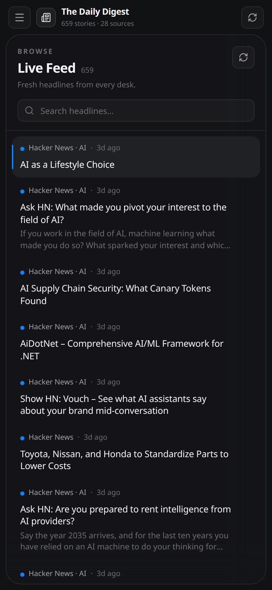

# The Daily Digest

A minimalist, Apple-style daily reader for **Artificial Intelligence** and
**Cybersecurity** news. Browse a live feed of headlines, or ask the editor to
synthesize the day into one calm, cited briefing.

> **Status:** Step 3 — the full reader is live: a three-column Apple-style
> interface over RSS ingestion, cross-feed deduplication, OPML import/export,
> and the Gemini editorial engine.

## Stack

| Layer | Choice |
| --- | --- |
| Framework | Next.js 16 (App Router) + React 19 + TypeScript |
| Styling | Tailwind CSS 4, Lucide icons |
| Database | SQLite via `better-sqlite3` + Drizzle ORM |
| Ingestion | `rss-parser` + `p-limit` |
| AI | Google Gemini (`gemini-3.8-flash`) via `@google/genai` |
| Reading | `react-markdown` + `remark-gfm` |
| OPML | `fast-xml-parser` |

## Quick start

```bash
npm install
cp .env.example .env           # add GEMINI_API_KEY for AI synthesis
npm run db:setup               # apply migrations + seed 2 categories & 28 sources
npm run dev
```

Open [http://localhost:3000](http://localhost:3000). The page server-renders the
latest articles and briefings, so a fresh database shows a guided setup state
instead of an empty shell.

## The interface

- **Sidebar** — desks (`All`, `AI`, `Cybersecurity`), saved stories, live
  counters, sync, and the sources manager. On narrow screens it becomes a
  drawer.
- **Feed panel** — Today's Read when a briefing exists, otherwise the live feed.
  Search, category filters, bookmarks, and cursor-free pagination via
  `limit`/`offset`.
- **Reader panel** — distraction-free article view or the rendered briefing with
  inline `[Source](url)` citations, read time, and generation errors surfaced as
  an inline banner plus a toast.

Optimistic bookmarks make saving instant, and the layout collapses to one panel
at a time below the `lg` breakpoint.

## Screenshots

**Reader** — search across 659 stories, then read without leaving the page.


**Sources** — add, validate, toggle, and move your feed list in and out with OPML.


**Mobile** — one panel at a time, with navigation in a drawer.



### Load today's news

```bash
curl -X POST http://localhost:3000/api/feeds/sync
curl http://localhost:3000/api/articles?limit=5
```

The sync endpoint fetches all active sources with bounded concurrency, records
`lastFetchedAt`, and deduplicates by canonicalized URL. One broken source never
aborts the batch — failures are returned in the report.

To write a briefing, add your `GEMINI_API_KEY` to `.env`, restart, then:

```bash
curl -X POST http://localhost:3000/api/briefings/generate \
  -H 'content-type: application/json' \
  -d '{"categorySlug":"ALL"}'
```

The database lives at `data/digest.db` and is ignored by git.

## Scripts

| Command | Description |
| --- | --- |
| `npm run dev` | Start the Next.js dev server |
| `npm run build` | Production build |
| `npm run start` | Serve the production build |
| `npm run db:setup` | Run migrations and seed if empty |
| `npm run db:seed` | Seed categories and starter sources |
| `npm run db:generate` | Generate a migration after editing the schema |
| `npm run db:push` | Push the schema directly to SQLite (prototyping) |
| `npm run db:studio` | Open Drizzle Studio |
| `npm run typecheck` | TypeScript, no emit |
| `npm run lint` | ESLint |

`npm run db:seed -- --force` adds any missing starter feeds to an existing
database without touching your articles or bookmarks. Seeding is always
idempotent.

## Project structure

```text
src/
├── app/
│   ├── api/
│   │   ├── articles/              # Browse, search, bookmark
│   │   ├── briefings/             # Latest briefing + generate
│   │   ├── feeds/sync/            # RSS ingestion (POST + cron GET)
│   │   ├── sources/               # Source CRUD + OPML import/export
│   │   └── stats/                 # Sidebar counters
│   ├── globals.css                # Obsidian surfaces, frosted glass, type tokens
│   ├── layout.tsx                 # Root shell, metadata, dark theme
│   └── page.tsx                   # Server-rendered initial digest
├── components/
│   ├── DigestApp.tsx              # Client orchestrator: fetch, sync, bookmarks
│   ├── Sidebar.tsx                # Desks, counters, sync, mobile drawer
│   ├── FeedPanel.tsx              # Briefing/feed list, search, pagination
│   ├── ReaderPanel.tsx            # Article and briefing reader
│   ├── ManageSourcesModal.tsx     # Add, validate, toggle, delete, OPML
│   └── Markdown.tsx               # GFM rendering with safe external links
├── db/
│   ├── index.ts                   # SQLite connection (WAL, FKs, dev singleton)
│   ├── schema.ts                  # categories · feeds · articles · briefings
│   └── seed.ts                    # Idempotent seed with 28 curated sources
├── hooks/
│   └── useDebouncedValue.ts       # Debounced search input
└── lib/
    ├── briefing.ts                # Story selection, prompt, Gemini, citations
    ├── categories.ts              # Shared slugs, labels, category metadata
    ├── client-api.ts              # Typed browser fetch wrapper
    ├── dedupe.ts                  # Title tokenization + near-duplicate removal
    ├── errors.ts                  # Typed application errors
    ├── format.ts                  # Relative time, read time, host labels
    ├── http.ts                    # JSON validation, auth, error envelopes
    ├── opml.ts                    # OPML 2.0 build/parse
    ├── rss.ts                     # Fetch, normalize, dedupe, batch upsert
    ├── server-queries.ts          # Shared list/stats queries for SSR + API
    ├── text.ts                    # HTML cleanup, read time, XML escaping
    ├── types.ts                   # API DTOs shared by client and server
    └── url.ts                     # URL canonicalization
drizzle/                           # Committed SQL migrations
data/                              # Local SQLite database (gitignored)
```

## Data model

- **categories** — editorial sections (`AI`, `CYBERSEC`) with an accent color.
- **feeds** — RSS/Atom sources, grouped by category. `sourceType` distinguishes
  `rss`, `community`, and `advisory` sources.
- **articles** — normalized headlines. `url` is globally unique, which is the
  backbone of cross-feed deduplication; `isBookmarked` powers the reading list.
- **briefings** — Gemini-written markdown briefings with read time and source
  count.

## API

| Method | Route | Purpose |
| --- | --- | --- |
| `POST` / `GET` | `/api/feeds/sync` | Sync active sources (optional `category`, `feedId`, `limit`, `concurrency`) |
| `GET` | `/api/articles` | Filter by `category`, `q`, `bookmarked`; paginate with `limit` + `offset` |
| `PATCH` | `/api/articles` | Set or toggle `isBookmarked` for an article id |
| `GET` | `/api/briefings` | Latest briefings, optional `category` + `limit` |
| `POST` | `/api/briefings/generate` | Deduplicate top stories and synthesize a briefing |
| `GET` | `/api/sources` | List sources with article counts |
| `POST` | `/api/sources` | Validate and add an RSS/Atom source |
| `PATCH` | `/api/sources` | Rename, recategorize, disable, or re-point a source |
| `DELETE` | `/api/sources?id=` | Remove a source and its articles |
| `GET` | `/api/sources/opml` | Export all sources as OPML |
| `POST` | `/api/sources/opml` | Import an OPML file (multipart `file` or raw XML) |
| `GET` | `/api/stats` | Article, source, bookmark, and briefing counters |

Errors use a stable envelope:

```json
{ "error": { "code": "INVALID_INPUT", "message": "category must be ALL, AI, or CYBERSEC." } }
```

### Editorial pipeline

1. Gather up to 240 recent stories (72-hour window, with a quiet-day fallback).
2. Collapse near-duplicate headlines using title-token Jaccard similarity.
3. Cap repeated coverage at two stories per source and balance AI vs. security.
4. Ask `gemini-3.8-flash` for structured JSON: a headline plus 600–800 words of
   Markdown with `##` sections and inline `[Source](url)` citations.
5. Strip any citation that does not match a supplied source, compute read time,
   and persist the briefing.

## Starter sources

**AI (16):** OpenAI, Google DeepMind, Google AI Blog, Google Research, Hugging
Face, The Verge AI, MIT Technology Review AI, Ars Technica, NVIDIA, arXiv cs.AI,
Import AI, The Gradient, Simon Willison, The Decoder, Hacker News, and Hacker
News AI.

**Cybersecurity (12):** The Hacker News, BleepingComputer, Krebs on Security,
CISA Advisories, Dark Reading, SecurityWeek, The Record, Schneier on Security,
SANS Internet Storm Center, Google Project Zero, CyberScoop, and Hacker News
Security.

## Environment

| Variable | Required | Description |
| --- | --- | --- |
| `DATABASE_URL` | No | SQLite path, default `./data/digest.db` |
| `GEMINI_API_KEY` | For synthesis | Google AI Studio API key |
| `GEMINI_MODEL` | No | Defaults to `gemini-3.8-flash` |
| `CRON_SECRET` | No | Optional protection for ingestion/synthesis endpoints |
| `SYNC_CONCURRENCY` | No | Parallel feed fetches, default `8` (max 50) |

## Deploying

The app is a single Node process plus a SQLite file, so it wants a host with a
persistent disk. Vercel's serverless filesystem is ephemeral and read-only at
runtime — the database would reset on every deploy.

1. Provision a host that keeps a volume (Fly.io, Railway, Render with a disk, or
   a small VPS) and mount it at `/data`.
2. Set `DATABASE_URL=/data/digest.db`, `GEMINI_API_KEY`, and optionally
   `CRON_SECRET`.
3. Build and start:

   ```bash
   npm ci
   npm run db:setup
   npm run build
   npm run start
   ```

4. Schedule ingestion and synthesis. With `CRON_SECRET` set, include it as a
   bearer token:

   ```bash
   curl -X POST https://your-host/api/feeds/sync \
     -H "authorization: Bearer $CRON_SECRET"
   curl -X POST https://your-host/api/briefings/generate \
     -H "authorization: Bearer $CRON_SECRET" \
     -H 'content-type: application/json' \
     -d '{"categorySlug":"ALL"}'
   ```

Run sync on a 30–60 minute cadence and generate once each morning. Back up the
SQLite file (or its volume snapshot) if you care about bookmarks.

## Roadmap

- [x] **Step 1** — scaffold, schema, migrations, seed
- [x] **Step 2** — RSS sync engine, deduplicator, Gemini briefing API
- [x] **Step 3** — three-column Apple-style reader, sources manager UI, OPML controls
- [x] **Step 4** — polished README, screenshots, deploy notes
