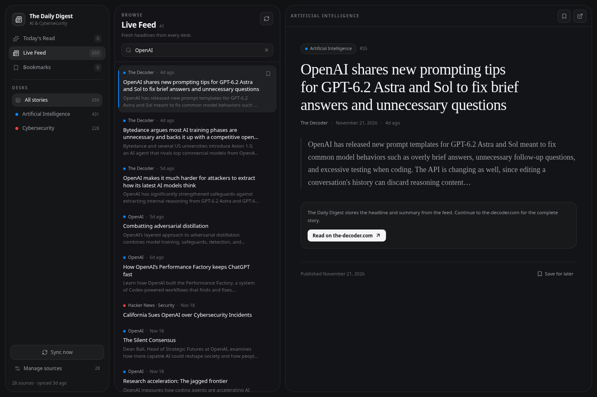
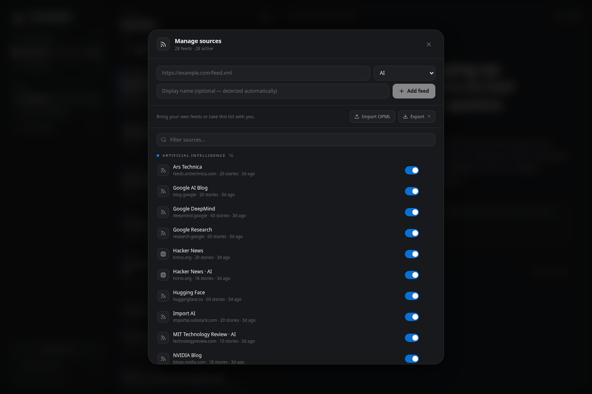

# Digestr

A minimalist, Apple-style daily reader for **Artificial Intelligence** and
**Cybersecurity** news. Browse a live feed of headlines, or ask the editor to
synthesize the day into one calm, cited briefing.

> **Status:** Step 6 — the reader ships as a native desktop app that works
> before you add a key. Tauri 2 runs the Next.js standalone server through a
> bundled Node sidecar, keeps SQLite in the OS app-data directory, seeds a
> Demo Mode library on first launch, and configures Gemini, Groq, or local
> Ollama entirely from an in-app Settings dialog.

## Stack

| Layer | Choice |
| --- | --- |
| Framework | Next.js 16 (App Router) + React 19 + TypeScript |
| Styling | Tailwind CSS 4, Lucide icons |
| Database | SQLite via `better-sqlite3` + Drizzle ORM |
| Ingestion | `rss-parser` + `p-limit` |
| AI | Google Gemini, Groq, or local Ollama, with an algorithmic fallback |
| Reading | `react-markdown` + `remark-gfm` |
| OPML | `fast-xml-parser` |
| Desktop | Tauri 2 + a bundled Node sidecar |

## Quick start

```bash
npm install
npm run db:setup               # apply migrations, seed sources, load Demo Mode
npm run dev
```

Open [http://localhost:3000](http://localhost:3000). A fresh database is seeded
with a small Demo Mode library — sample stories and pre-written briefings — so
the reader is complete before you add a key or sync a feed. Add a provider in
Settings whenever you want live AI synthesis.

Prefer a native window? Jump to [Desktop app (Tauri)](#desktop-app-tauri).

## The interface

- **Sidebar** — desks (`All`, `AI`, `Cybersecurity`), saved stories, live
  counters, sync, and the sources manager. On narrow screens it becomes a
  drawer.
- **Feed panel** — Today's Read when a briefing exists, otherwise the live feed.
  Search, category filters, bookmarks, and cursor-free pagination via
  `limit`/`offset`.
- **Reader panel** — distraction-free article view or the rendered briefing with
  inline `[Source](url)` citations, read time, and generation errors surfaced as
  an inline banner plus a toast.

Optimistic bookmarks make saving instant, and the layout collapses to one panel
at a time below the `lg` breakpoint.

## Demo Mode and providers

A fresh install opens with **Demo Mode** on: 20 sample stories from 20 real
publisher desks and three pre-written briefings, clearly labelled `Demo` /
`Sample`. Nothing needs a key, account, or network connection.

Open **Settings** (gear icon) to choose how live briefings are written:

| Provider | Notes |
| --- | --- |
| **Google Gemini** | Default cloud provider; tested with a one-token request |
| **Groq** | Fast free-tier alternative (`llama-3.3-70b-versatile` by default) |
| **Ollama** | Local inference at `http://localhost:11434`; nothing leaves the machine |
| **Automatic** | Gemini → Groq → Ollama, then the built-in editor |
| **Algorithmic fallback** | Groups related coverage and writes a cited brief without a model |

Each provider has its own **Test Connection** button. Keys are stored in the
local SQLite database with owner-only permissions and masked in every response.
If a provider is missing, offline, or fails mid-request, generation falls back
automatically and the response says which editor wrote the read. Sync real
coverage and the samples clear themselves; **Reset / Load Demo Data** brings
them back.

## Screenshots

**Reader** — search across 659 stories, then read without leaving the page.



**Sources** — add, validate, toggle, and move your feed list in and out with OPML.



**Mobile** — one panel at a time, with navigation in a drawer.


## Desktop app (Tauri)

The same reader ships as a native Linux/Windows application. Tauri starts a
bundled Node sidecar that runs the Next.js standalone server on a free loopback
port, waits for `/api/health`, and opens a native window pointed at it. API
routes, Drizzle migrations, and the `better-sqlite3` native module are preserved
unchanged.

- **Local data** lives outside the app bundle, in the OS app-data directory:
  - Linux: `~/.local/share/com.digestr.desktop/digest.db`
  - Windows: `%APPDATA%\com.digestr.desktop\digest.db`
- **First launch** applies committed migrations, seeds the 28 starter sources,
  and loads the Demo Mode library. No key, account, or network connection is
  required to read.
- **Providers** are configured from the gear icon: Google Gemini, Groq, or a
  local Ollama instance at `http://localhost:11434`. Keys are stored in the
  local database with owner-only permissions, masked in API responses, and
  validated with a per-provider **Test connection** button. When no provider is
  configured, offline, or failing, the built-in algorithmic editor still
  assembles a cited read.
- **Demo Mode** is labelled in the feed, reader, and a dismissible banner. Sync
  real coverage and the samples clear themselves, or use **Reset / Load Demo
  Data** in Settings to restore them.
- **Updates** are signed and checked against GitHub Releases on launch. Settings
  also has **Check for updates**.
- **Links** open in the system browser, so the app never traps you in a bare
  webview.
- **Single instance** — launching the app again focuses the existing window
  instead of starting a second SQLite writer.

### Build locally

Prerequisites: Rust (via rustup), Node 22, and the
[Tauri system dependencies](https://v2.tauri.app/start/prerequisites/) for your
OS. On Debian/Ubuntu:

```bash
sudo apt-get install libwebkit2gtk-4.1-dev libayatana-appindicator3-dev \
  librsvg2-dev patchelf libgtk-3-dev build-essential
```

Then:

```bash
npm install
npm run desktop:dev
```

`desktop:dev` builds the standalone runtime and starts Tauri. To produce
installers:

```bash
# Linux: AppImage + .deb
npm run desktop:build -- --bundles appimage,deb

# Windows: NSIS installer (.exe) + MSI
npm run desktop:build -- --bundles nsis,msi
```

Under the hood, `npm run desktop:prepare` runs `next build`, copies
`.next/static`, `public/` (when present), and `drizzle/` into
`.next/standalone`, and places a self-contained Node executable at
`src-tauri/binaries/digest-node-<target-triple>`. If the host Node is a thin
wrapper around a shared `libnode`, the script downloads the official build for
the same version. Sidecar binaries and Rust build output are gitignored.

### Release workflow

Push a tag such as `v0.2.0` and
[`.github/workflows/release.yml`](.github/workflows/release.yml) builds on native
Ubuntu 22.04 and Windows runners with
[`tauri-apps/tauri-action`](https://github.com/tauri-apps/tauri-action). It
publishes a draft GitHub release with the AppImage, `.deb`, NSIS `.exe`, MSI,
signature files, and the merged `latest.json` updater manifest. The workflow
syncs the tag version into `package.json` and `src-tauri/tauri.conf.json` before
building.

Add these repository secrets before the first tagged release:

| Secret | Value |
| --- | --- |
| `TAURI_SIGNING_PRIVATE_KEY` | Contents of the updater private key |
| `TAURI_SIGNING_PRIVATE_KEY_PASSWORD` | Password chosen when the key was generated |

The matching public key lives in `src-tauri/tauri.conf.json` under
`plugins.updater.pubkey`, and the endpoint points at
`https://github.com/Will22102s/Digestr-the-news-app/releases/latest/download/latest.json`.
Keep the private key out of the repository; losing it means existing installs
cannot verify future updates.

## Load today's news

```bash
curl -X POST http://localhost:3000/api/feeds/sync
curl http://localhost:3000/api/articles?limit=5
```

The sync endpoint fetches all active sources with bounded concurrency, records
`lastFetchedAt`, and deduplicates by canonicalized URL. One broken source never
aborts the batch — failures are returned in the report.

To write a briefing in the browser, open **Settings** (gear icon), add a Gemini
or Groq key, or enable local Ollama, then click **Generate Your Read**. With no
provider configured the request still succeeds: the built-in algorithmic editor
groups related coverage and cites every source. For scripted use with Gemini,
you can instead put `GEMINI_API_KEY` in `.env`, restart, and call:

```bash
curl -X POST http://localhost:3000/api/briefings/generate \
  -H 'content-type: application/json' \
  -d '{"categorySlug":"ALL"}'
```

The database lives at `data/digest.db` and is ignored by git.

## Scripts

| Command | Description |
| --- | --- |
| `npm run dev` | Start the Next.js dev server |
| `npm run build` | Production build |
| `npm run start` | Serve the production build |
| `npm run db:setup` | Run migrations and seed if empty |
| `npm run db:seed` | Seed categories and starter sources |
| `npm run db:generate` | Generate a migration after editing the schema |
| `npm run db:push` | Push the schema directly to SQLite (prototyping) |
| `npm run db:studio` | Open Drizzle Studio |
| `npm run desktop:dev` | Build the standalone runtime and start the Tauri app |
| `npm run desktop:build` | Build native installers with Tauri |
| `npm run desktop:prepare` | Build/copy the standalone runtime and Node sidecar |
| `npm run typecheck` | TypeScript, no emit |
| `npm run lint` | ESLint |

`npm run db:seed -- --force` adds any missing starter feeds to an existing
database without touching your articles or bookmarks. Seeding is always
idempotent.

## Project structure

```text
src/
├── app/
│   ├── api/
│   │   ├── articles/              # Browse, search, bookmark
│   │   ├── briefings/             # Latest briefing + generate
│   │   ├── demo/                  # Reset / load / clear the sample library
│   │   ├── feeds/sync/            # RSS ingestion (POST + cron GET)
│   │   ├── health/                # Sidecar readiness probe
│   │   ├── settings/              # Provider keys, models, and test connection
│   │   ├── sources/               # Source CRUD + OPML import/export
│   │   └── stats/                 # Sidebar counters, demo + AI status
│   ├── globals.css                # Obsidian surfaces, frosted glass, type tokens
│   ├── layout.tsx                 # Root shell, metadata, dark theme
│   └── page.tsx                   # Server-rendered initial digest
├── components/
│   ├── DigestApp.tsx              # Client orchestrator: fetch, sync, bookmarks
│   ├── Sidebar.tsx                # Desks, counters, sync, mobile drawer
│   ├── FeedPanel.tsx              # Briefing/feed list, search, pagination
│   ├── ReaderPanel.tsx            # Article and briefing reader
│   ├── ManageSourcesModal.tsx     # Add, validate, toggle, delete, OPML
│   ├── SettingsModal.tsx          # Provider cards, tests, demo reset, updates
│   └── Markdown.tsx               # GFM rendering with safe external links
├── db/
│   ├── index.ts                   # SQLite connection (WAL, FKs, app-data path)
│   ├── bootstrap.ts               # Runtime migrations + idempotent seed
│   ├── demo-data.ts               # Demo Mode stories, briefings, reset helpers
│   ├── starter-feeds.ts           # 28 curated sources
│   ├── schema.ts                  # categories · feeds · articles · briefings · settings
│   └── seed.ts                    # CLI wrapper around bootstrap
├── hooks/
│   └── useDebouncedValue.ts       # Debounced search input
├── instrumentation.ts             # Boots the DB before the server is ready
└── lib/
    ├── ai-providers.ts            # Gemini, Groq, and Ollama adapters + tests
    ├── briefing.ts                # Story selection, prompts, fallback, citations
    ├── categories.ts              # Shared slugs, labels, category metadata
    ├── client-api.ts              # Typed browser fetch wrapper
    ├── dedupe.ts                  # Title tokenization + near-duplicate removal
    ├── errors.ts                  # Typed application errors
    ├── format.ts                  # Relative time, read time, host labels
    ├── http.ts                    # JSON validation, auth, error envelopes
    ├── opml.ts                    # OPML 2.0 build/parse
    ├── rss.ts                     # Fetch, normalize, dedupe, batch upsert
    ├── server-queries.ts          # Shared list/stats queries for SSR + API
    ├── settings.ts                # Provider config, masking, precedence
    ├── text.ts                    # HTML cleanup, read time, XML escaping
    ├── types.ts                   # API DTOs shared by client and server
    └── url.ts                     # URL canonicalization
scripts/                           # Standalone + Node sidecar preparation
src-tauri/                         # Tauri shell and Rust sidecar supervisor
drizzle/                           # Committed SQL migrations
data/                              # Local SQLite database (gitignored)
```

## Data model

- **categories** — editorial sections (`AI`, `CYBERSEC`) with an accent color.
- **feeds** — RSS/Atom sources, grouped by category. `sourceType` distinguishes
  `rss`, `community`, and `advisory` sources.
- **articles** — normalized headlines. `url` is globally unique, which is the
  backbone of cross-feed deduplication; `isBookmarked` powers the reading list.
  `isDemo` marks sample stories so they can be cleared without touching live data.
- **briefings** — markdown briefings with read time, source count, the
  `provider` that wrote them, and an `isDemo` flag for the bundled samples.
- **settings** — local key/value preferences. Provider keys and models are
  stored here; key reads are masked before leaving the server.

## API

| Method | Route | Purpose |
| --- | --- | --- |
| `POST` / `GET` | `/api/feeds/sync` | Sync active sources (optional `category`, `feedId`, `limit`, `concurrency`) |
| `GET` | `/api/articles` | Filter by `category`, `q`, `bookmarked`; paginate with `limit` + `offset` |
| `PATCH` | `/api/articles` | Set or toggle `isBookmarked` for an article id |
| `GET` | `/api/briefings` | Latest briefings, optional `category` + `limit` |
| `POST` | `/api/briefings/generate` | Deduplicate top stories and synthesize a briefing |
| `GET` | `/api/sources` | List sources with article counts |
| `POST` | `/api/sources` | Validate and add an RSS/Atom source |
| `PATCH` | `/api/sources` | Rename, recategorize, disable, or re-point a source |
| `DELETE` | `/api/sources?id=` | Remove a source and its articles |
| `GET` | `/api/sources/opml` | Export all sources as OPML |
| `POST` | `/api/sources/opml` | Import an OPML file (multipart `file` or raw XML) |
| `GET` | `/api/stats` | Article, source, bookmark, briefing, demo, and AI counters |
| `GET` | `/api/health` | Sidecar readiness probe (SQLite ping) |
| `GET` | `/api/demo` | Demo Mode status and sample counts |
| `POST` | `/api/demo` | `reset`, `load`, or `clear` the sample library |
| `GET` | `/api/settings` | Provider status with masked keys |
| `PUT` | `/api/settings` | Save or clear provider keys, models, and preferences |
| `POST` | `/api/settings/test` | Validate a provider without persisting it |

Errors use a stable envelope:

```json
{ "error": { "code": "INVALID_INPUT", "message": "category must be ALL, AI, or CYBERSEC." } }
```

### Editorial pipeline

1. Gather up to 240 recent stories (72-hour window, with a quiet-day fallback).
2. Collapse near-duplicate headlines using title-token Jaccard similarity.
3. Cap repeated coverage at two stories per source and balance AI vs. security.
4. Resolve the preferred provider (`auto` picks Gemini → Groq → Ollama) and ask
   for structured JSON: a headline plus 600–800 words of Markdown with `##`
   sections and inline `[Source](url)` citations. If no provider is available or
   the request fails, the algorithmic editor groups stories by shared keywords
   and writes the same shape of cited brief.
5. Strip any citation that does not match a supplied source, compute read time,
   and persist the briefing with its provider.

## Starter sources

**AI (16):** OpenAI, Google DeepMind, Google AI Blog, Google Research, Hugging
Face, The Verge AI, MIT Technology Review AI, Ars Technica, NVIDIA, arXiv cs.AI,
Import AI, The Gradient, Simon Willison, The Decoder, Hacker News, and Hacker
News AI.

**Cybersecurity (12):** The Hacker News, BleepingComputer, Krebs on Security,
CISA Advisories, Dark Reading, SecurityWeek, The Record, Schneier on Security,
SANS Internet Storm Center, Google Project Zero, CyberScoop, and Hacker News
Security.

## Environment

| Variable | Required | Description |
| --- | --- | --- |
| `DATABASE_URL` | No | SQLite path, default `./data/digest.db` |
| `DIGEST_DATA_DIR` | Desktop | OS app-data directory injected by Tauri; the DB is `<dir>/digest.db` |
| `AI_PROVIDER` | No | `auto`, `gemini`, `groq`, `ollama`, or `fallback` |
| `GEMINI_API_KEY` | No | Optional fallback; a key saved in Settings wins |
| `GEMINI_MODEL` | No | Defaults to `gemini-3.8-flash` |
| `GROQ_API_KEY` | No | Optional Groq fallback |
| `GROQ_MODEL` | No | Defaults to `llama-3.3-70b-versatile` |
| `OLLAMA_ENABLED` | No | `true` to allow local Ollama inference |
| `OLLAMA_BASE_URL` | No | Defaults to `http://localhost:11434` |
| `OLLAMA_MODEL` | No | Defaults to `llama3.1` |
| `CRON_SECRET` | No | Optional protection for ingestion/synthesis endpoints |
| `SYNC_CONCURRENCY` | No | Parallel feed fetches, default `8` (max 50) |

## Deploying

The app is a single Node process plus a SQLite file, so it wants a host with a
persistent disk. Vercel's serverless filesystem is ephemeral and read-only at
runtime — the database would reset on every deploy.

1. Provision a host that keeps a volume (Fly.io, Railway, Render with a disk, or
   a small VPS) and mount it at `/data`.
2. Set `DATABASE_URL=/data/digest.db`, optionally a provider key (or
   `AI_PROVIDER=fallback` to skip cloud inference), and `CRON_SECRET`.
3. Build and start:

   ```bash
   npm ci
   npm run db:setup
   npm run build
   npm run start
   ```

4. Schedule ingestion and synthesis. With `CRON_SECRET` set, include it as a
   bearer token:

   ```bash
   curl -X POST https://your-host/api/feeds/sync \
     -H "authorization: Bearer $CRON_SECRET"
   curl -X POST https://your-host/api/briefings/generate \
     -H "authorization: Bearer $CRON_SECRET" \
     -H 'content-type: application/json' \
     -d '{"categorySlug":"ALL"}'
   ```

Run sync on a 30–60 minute cadence and generate once each morning. Back up the
SQLite file (or its volume snapshot) if you care about bookmarks.

## Roadmap

- [x] **Step 1** — scaffold, schema, migrations, seed
- [x] **Step 2** — RSS sync engine, deduplicator, Gemini briefing API
- [x] **Step 3** — three-column Apple-style reader, sources manager UI, OPML controls
- [x] **Step 4** — polished README, screenshots, deploy notes
- [x] **Step 5** — Tauri 2 desktop app, app-data SQLite, in-app Gemini settings,
  tag-driven Linux/Windows releases
- [x] **Step 6** — Digestr rename, keyless Demo Mode, Gemini/Groq/Ollama
  providers with algorithmic fallback, signed auto-updates, and a
  Linux/Windows release pipeline
